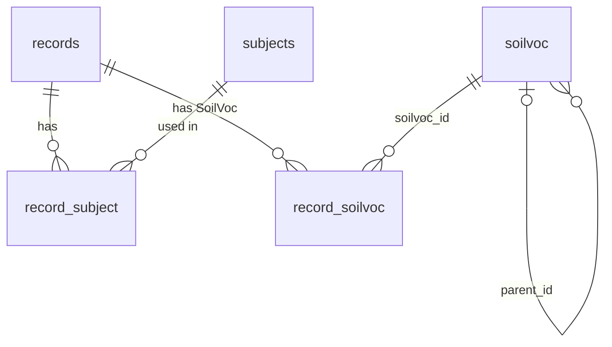

# DB schema: records, subjects and SoilVoc

Stage DB `msp-kh-stage`, schema `validate`. Definitions read from the live stage DB on 3 November 2026.

- `records`: 33,566 rows
- `record_subject`: 102,270 rows
- `subjects`: 19,282 rows
- `record_soilvoc`: 18,601 rows
- `soilvoc`: 1,464 rows



## SQL

```sql
-- Records (metadata of datasets, articles, projects, ...)
CREATE TABLE validate.records (
    id                     uuid        NOT NULL,
    identifier             text        NOT NULL,
    title                  text        NOT NULL,
    abstract               text,
    resource_type          text,
    license                text,
    language               text,
    thumbnail              text,
    publication_date       timestamptz,
    resource_creation_date timestamptz,
    resource_updated_date  timestamptz,
    harvest_date           timestamptz,
    spatial                text,
    temporal_start         timestamptz,
    temporal_end           timestamptz,
    raw_metadata           jsonb,
    created_at             timestamptz NOT NULL DEFAULT now(),
    updated_at             timestamptz NOT NULL DEFAULT now(),
    approval_status        varchar(50) NOT NULL DEFAULT 'pending',
    url                    text,
    CONSTRAINT records_pkey           PRIMARY KEY (id),
    CONSTRAINT records_identifier_key UNIQUE (identifier),
    CONSTRAINT records_url_format_ck  CHECK (url IS NULL OR url ~ '^https?://[^\s]+$')
);

-- Subjects / keywords (one row per distinct label)
CREATE TABLE validate.subjects (
    id              uuid        NOT NULL,
    uri             text,
    label           text        NOT NULL,
    vocabulary_name text,
    vocabulary_url  text,
    created_at      timestamptz NOT NULL DEFAULT now(),
    updated_at      timestamptz NOT NULL DEFAULT now(),
    CONSTRAINT subjects_pkey PRIMARY KEY (id)
);

-- Which record uses which subject
CREATE TABLE validate.record_subject (
    id         uuid        NOT NULL,
    record_id  uuid        NOT NULL,
    subject_id uuid        NOT NULL,
    created_at timestamptz NOT NULL DEFAULT now(),
    updated_at timestamptz NOT NULL DEFAULT now(),
    CONSTRAINT record_subject_pkey PRIMARY KEY (id),
    CONSTRAINT uq_record_subject   UNIQUE (record_id, subject_id),
    CONSTRAINT record_subject_record_id_fkey  FOREIGN KEY (record_id)  REFERENCES validate.records(id)  ON DELETE CASCADE,
    CONSTRAINT record_subject_subject_id_fkey FOREIGN KEY (subject_id) REFERENCES validate.subjects(id) ON DELETE CASCADE
);

-- SoilVoc vocabulary (one row per concept)
CREATE TABLE validate.soilvoc (
    id         text     NOT NULL,
    level      smallint,
    parent_id  text,
    name       text     NOT NULL,
    alt_labels text[],
    CONSTRAINT soilvoc_pkey           PRIMARY KEY (id),
    CONSTRAINT soilvoc_level_check    CHECK (level >= 1 AND level <= 8),
    CONSTRAINT soilvoc_parent_id_fkey FOREIGN KEY (parent_id) REFERENCES validate.soilvoc(id)
);
CREATE INDEX soilvoc_parent_id_idx ON validate.soilvoc (parent_id);

-- SoilVoc concepts of each record
CREATE TABLE validate.record_soilvoc (
    record_id     uuid        NOT NULL,
    soilvoc_id    text        NOT NULL,
    link_type     text        NOT NULL,
    status        text        NOT NULL DEFAULT 'accepted',
    run_id        text        NOT NULL,
    classified_at timestamptz NOT NULL DEFAULT now(),
    CONSTRAINT record_soilvoc_pkey PRIMARY KEY (record_id, soilvoc_id),
    CONSTRAINT record_soilvoc_record_id_fkey  FOREIGN KEY (record_id)  REFERENCES validate.records(id) ON DELETE CASCADE,
    CONSTRAINT record_soilvoc_soilvoc_id_fkey FOREIGN KEY (soilvoc_id) REFERENCES validate.soilvoc(id),
    CONSTRAINT record_soilvoc_link_type_check CHECK (link_type IN
        ('exact', 'synonym', 'translation', 'mapped', 'variant', 'broader', 'inside')),
    CONSTRAINT record_soilvoc_status_check CHECK (status IN ('accepted', 'pending'))
);
CREATE INDEX record_soilvoc_soilvoc_id_idx ON validate.record_soilvoc (soilvoc_id);
```

## `records`

One row per harvested metadata record (journal article, practice abstract, dataset, project, document, …).

| Field | Type | Null | Key / default | Description |
|---|---|---|---|---|
| `id` | uuid | no | PK | Internal ID of the record |
| `identifier` | text | no | unique | Identifier from the source catalogue (e.g. a UUID or DOI) |
| `title` | text | no | | Title of the resource |
| `abstract` | text | yes | | Abstract or description |
| `resource_type` | text | yes | | Kind of resource: Journal Article, Practice Abstract, Dataset, Project, Document, Other |
| `license` | text | yes | | Licence of the resource |
| `language` | text | yes | | Language of the metadata (English, Italian, German, …) |
| `thumbnail` | text | yes | | Link to a preview image |
| `publication_date` | timestamptz | yes | | Date the resource was published |
| `resource_creation_date` | timestamptz | yes | | Date the resource was created |
| `resource_updated_date` | timestamptz | yes | | Date the resource was last updated at the source |
| `harvest_date` | timestamptz | yes | | Date the record was harvested |
| `spatial` | text | yes | | Spatial extent as WKT (e.g. `POLYGON((…))`) |
| `temporal_start` | timestamptz | yes | | Start of the period the resource covers |
| `temporal_end` | timestamptz | yes | | End of the period the resource covers |
| `raw_metadata` | jsonb | yes | | Original harvested metadata as JSON (title, sources, links, contacts, …) |
| `created_at` | timestamptz | no | `now()` | When the row was created |
| `updated_at` | timestamptz | no | `now()` | When the row was last changed |
| `approval_status` | varchar(50) | no | `'pending'` | Review state of the record (`approved`, `disapproved`, `pending`) |
| `url` | text | yes | check `http(s)://…` | Link to the resource's landing page |

## `subjects`

One row per distinct subject / keyword label. Shared by all records that use it.

| Field | Type | Null | Key / default | Description |
|---|---|---|---|---|
| `id` | uuid | no | PK | Internal ID of the subject |
| `uri` | text | yes | | URI of the subject in a vocabulary (empty today) |
| `label` | text | no | | The keyword as harvested; never changed by the SoilVoc work |
| `vocabulary_name` | text | yes | | `noise` = the subject is noise and can be hidden (SDG labels, codes, portal tags, grant numbers; 1,534 subjects); empty = everything else |
| `vocabulary_url` | text | yes | | URL of the vocabulary (empty today) |
| `created_at` | timestamptz | no | `now()` | When the row was created |
| `updated_at` | timestamptz | no | `now()` | When the row was last changed |

## `record_subject`

Link table: which record uses which subject.

| Field | Type | Null | Key / default | Description |
|---|---|---|---|---|
| `id` | uuid | no | PK | Internal ID of the link |
| `record_id` | uuid | no | FK → `records.id`, unique with `subject_id` | The record |
| `subject_id` | uuid | no | FK → `subjects.id` | The subject used by the record |
| `created_at` | timestamptz | no | `now()` | When the link was created |
| `updated_at` | timestamptz | no | `now()` | When the link was last changed |

## `soilvoc`

The SoilVoc vocabulary: one row per concept (loaded from `SoilVoc.ttl`).

| Field | Type | Null | Key / default | Description |
|---|---|---|---|---|
| `id` | text | no | PK | SoilVoc URI of the concept, e.g. `https://w3id.org/eusoilvoc#SoilErosion` |
| `level` | smallint | yes | check 1–8 | Depth in the hierarchy: 1 = top concept (e.g. soil threats) to 8; empty for the 249 lab procedure codes outside the hierarchy |
| `parent_id` | text | yes | FK → `soilvoc.id` | Broader concept one level up (e.g. soil erosion → soil threats); empty for top concepts |
| `name` | text | no | | English preferred label, e.g. "soil erosion" |
| `alt_labels` | text[] | yes | | Alternative labels and translations from SoilVoc |

## `record_soilvoc`

The SoilVoc concepts of each record: one row per record and concept.

| Field | Type | Null | Key / default | Description |
|---|---|---|---|---|
| `record_id` | uuid | no | PK, FK → `records.id` | The record (row is deleted with the record) |
| `soilvoc_id` | text | no | PK, FK → `soilvoc.id` | The SoilVoc concept |
| `link_type` | text | no | check list | How the record's subjects matched the concept: `exact` (same label), `synonym` (same meaning), `translation` (non-English keyword), `mapped` (via AGROVOC/GEMET/USDA), `variant` (spelling/plural), `broader` (subject is narrower than the concept), `inside` (term found inside a longer keyword, weaker) |
| `status` | text | no | `'accepted'`, check list | `accepted` = counted; `pending` = a person still has to accept it (e.g. FAO vs WRB soil type) |
| `run_id` | text | no | | Load run that wrote the row, e.g. `20261103-160240` |
| `classified_at` | timestamptz | no | `now()` | When the row was written |
