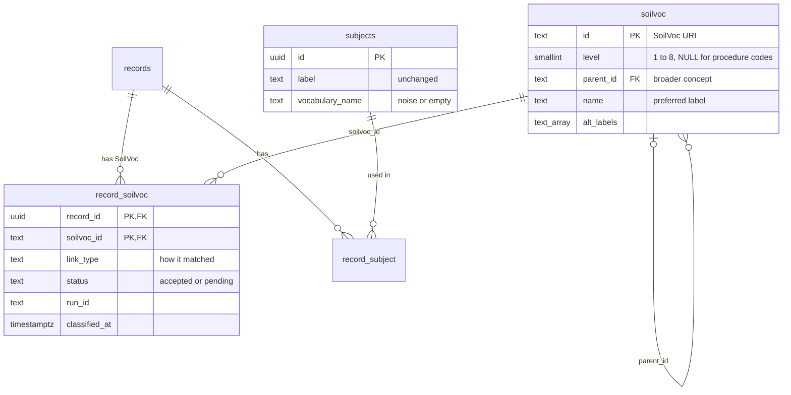
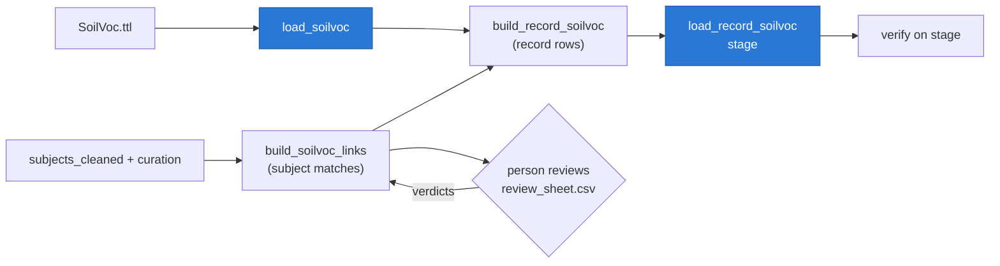

# Implementation: SoilVoc linked to records (`soilvoc` + `record_soilvoc`)

Steps to load SoilVoc into the DB and link it to records, so keyword/subject noise filtering and
SoilVoc filters work.

**Target environment: stage only** (`DB_*1` = `msp-kh-stage`, schema `validate`, credentials from
`.env`). The scripts accept only `--db 1`; dev is never written.

**PO decisions (3 November 2026)**
- SoilVoc is linked directly to **records**, not to subjects.
- The vocabulary table is called **`soilvoc`**, its key is **`id`** (parent: `parent_id`).
- `record_soilvoc` is connected to `soilvoc` by **`soilvoc_id`** (foreign key).
- No level roll-up columns (l1/l2/l3) in `record_soilvoc`; filters use the `soilvoc` tree.

## Status

- **Step 1 DDL:** ✅ done on stage (`soilvoc`, `record_soilvoc`; old tables renamed or dropped).
- **Step 2 Load `soilvoc`:** ✅ 1,464 concepts, matches `soilvoc_hierarchy.json` exactly (0 mismatches).
- **Step 3 Subject matches (dry run):** ✅ `dry_run_links.csv`, intermediate file, not loaded.
- **Step 4 Record rows (dry run):** ✅ `dry_run_record_soilvoc.csv`, 18,601 rows.
- **Step 5 Human review:** ⏳ open, `review_sheet.csv`, 257 rows.
- **Step 6 Load `record_soilvoc` + noise marks:** ✅ done on stage (run `20261103-160240`).
- **Step 7 Verify on stage:** ✅ all checks passed.
- **Step 8 API/UI:** ⬜ not started.
- **Step 9 Harvest integration:** ⬜ not started.

**Stage today** (run `20261103-160240`): `soilvoc` (1,464 concepts), `record_soilvoc` (18,601 rows),
`subjects.vocabulary_name = 'noise'` on 1,534 subjects (nothing else marked).
`soilvoc_types`, `subject_soilvoc` and the array-shaped `record_soilvoc` no longer exist.
Backup of subjects before this run: `validate.subjects_pre_soilvoc_backup_20261103_160240`.

## Tables



**`soilvoc`** (one row per SoilVoc concept)
- `id`: SoilVoc URI, the concept's ID (e.g. `https://w3id.org/eusoilvoc#SoilErosion`)
- `level`: depth in the hierarchy, 1 (top concept) to 8; NULL for the 249 lab procedure codes outside the hierarchy
- `parent_id`: the broader concept one level up (FK to `soilvoc.id`), the same tree as `soilvoc_hierarchy.json`; 131 concepts have several parents, all listed in `multi_parent_concepts.csv`
- `name`: English preferred label
- `alt_labels`: alternative labels and translations from SoilVoc

**`record_soilvoc`** (one row per record and SoilVoc concept; primary key `(record_id, soilvoc_id)`)
- `record_id`: the record (FK to `records`, deleted with the record)
- `soilvoc_id`: the SoilVoc concept (FK to `soilvoc.id`)
- `link_type`: how it matched. If several subjects of the record give the same concept, the strongest is kept: `exact` > `synonym` > `translation` > `mapped` > `variant` > `broader` > `inside`
  - `exact`: a subject is the SoilVoc label
  - `synonym`: same meaning, other word
  - `translation`: a non-English keyword translated to the SoilVoc term
  - `mapped`: matched through AGROVOC / GEMET / USDA labels linked in SoilVoc
  - `variant`: spelling, plural or accent difference
  - `broader`: the subject is narrower than the concept (climate change → climate)
  - `inside`: the SoilVoc term was found inside a longer keyword (weaker link)
- `status`: `accepted`, or `pending` when a person still has to accept it (e.g. Podzols FAO vs WRB, unclear matches)
- `run_id`, `classified_at`: which load run wrote the row, and when

**`subjects.vocabulary_name`** (existing column)
- `noise`: the subject is noise and can be hidden (SDG labels, codes, portal tags, grant numbers)
- empty: everything else

## How a record gets its SoilVoc concepts

1. Each subject is cleaned and matched to SoilVoc in CSV (`clean_subjects.py`, curation files, inside-keyword review).
2. `build_soilvoc_links.py` writes the subject-level matches (`dry_run_links.csv`) and the noise list (`noise_subjects.csv`). Wrong matches from the review are left out.
3. `build_record_soilvoc.py` reads stage (read-only) for `record_subject` and `soilvoc`, and for each record takes the matches of all its subjects: one row per concept, the strongest link type, `accepted` if any subject gives a reviewed match, otherwise `pending`.
4. `load_record_soilvoc.py` loads that file into `record_soilvoc` and sets the noise marks.

No subject IDs are stored in `record_soilvoc`: the link is between the record and SoilVoc only.

## Numbers on stage

- **18,601 rows**: 18,368 `accepted`, 233 `pending`
- **6,048 records** with an accepted concept; **5,914** with a direct one (not only `inside`)
- **456 concepts** accepted (447 from direct matches)
- **180 records** with pending concepts
- **1,534 noise subjects**, 43,957 uses
- Accepted rows by link type: exact 12,801 · synonym 2,059 · broader 1,919 · inside 927 · mapped 572 · translation 50 · variant 40

Compared with the earlier subject-level load (483 concepts, 6,050 records, 5,916 direct): the
difference is the unreviewed candidates, mostly concepts that could mean two SoilVoc terms (FAO vs
WRB soil types). They are now `pending` instead of counted. Once a person accepts them in
`review_sheet.csv`, they become `accepted`.

Soil threats filter (accepted, direct, including narrower terms): soil pollution 392, soil
degradation 234, soil erosion 227, soil compaction 115, soil sealing 80, soil biodiversity loss 36,
soil acidification 31, soil organic carbon loss 20, soil nutrient loss 15, waterlogging 14;
883 records under soil threats.

## Step 1: DDL ✅

- Files: `Augmentation/SoilVoc/07_populate_soilvoc_db/scripts/sql/create_soilvoc_tables.sql`, runner `Augmentation/SoilVoc/07_populate_soilvoc_db/scripts/create_soilvoc_tables.py`
- Run: `python3 Augmentation/SoilVoc/07_populate_soilvoc_db/scripts/create_soilvoc_tables.py --db 1`
- Idempotent. On an existing install it:
  - renames `soilvoc_types` → `soilvoc`, `code` → `id`, `parent_code` → `parent_id` (and the constraint names)
  - drops the array-shaped `record_soilvoc` and creates the new one
  - drops `subject_soilvoc`
- `record_soilvoc` checks: primary key `(record_id, soilvoc_id)`, FKs to `records` and `soilvoc`, `link_type` and `status` from fixed lists; index on `soilvoc_id`; `soilvoc` has an index on `parent_id`

## Step 2: Load `soilvoc` ✅

- Run: `python3 scripts/load_soilvoc.py --db 1`
- Parses `SoilVoc.ttl`; `parent_id` = tree parent from the same BFS as `Augmentation/SoilVoc/04_soilvoc_hierarchy/scripts/soilvoc_levels.py`, so stage matches `Augmentation/SoilVoc/04_soilvoc_hierarchy/outputs/soilvoc_hierarchy.json`
- Detached procedure codes keep their detached group code as parent (27 rows, level NULL)
- Check: `python3 scripts/check_soilvoc_vs_json.py` → 0 mismatches
- Idempotent upsert, never truncates

## Step 3: Subject matches (dry run, no DB writes)

- Run: `python3 Augmentation/SoilVoc/07_populate_soilvoc_db/scripts/build_soilvoc_links.py`
- Reads `Augmentation/SoilVoc/06_keyword_cleaning/outputs/subjects_cleaned.csv` and `Augmentation/SoilVoc/curation/inside_keyword_review.csv` (plus verdicts from `review_sheet.csv` if filled)
- Writes `dry_run_links.csv` (subject–concept matches) and `noise_subjects.csv`
- Rules: `soilvoc` → link type from the match, reviewed; inside-keyword `same`/`narrower` → `inside`, reviewed; `unclear` → `inside`, not reviewed; `wrong` → left out; ambiguous → every candidate, not reviewed
- Noise: a subject is `noise` only if every part of it is noise or a category label, and it has no SoilVoc match

## Step 4: Record rows (dry run, read-only)

- Run: `python3 scripts/build_record_soilvoc.py`
- Writes `dry_run_record_soilvoc.csv`: `record_id`, `soilvoc_id`, `link_type`, `status` (plus name and level for reading)

## Step 5: Human review ⏳

- `review_sheet.csv`, 257 rows in priority order; fill `verdict` with `keep` or `drop`, then re-run steps 3, 4 and 6
- Groups: 111 unreviewed candidates (ambiguous and unclear), 138 `broader` matches, 5 doubtful direct matches (`biomass`, `crop biomass`, `immissionen`, `inputs`, `filtration`), 3 pairs missing from the inside-keyword review
- Also open: a person check of the 2,598 AI-made translations in `Augmentation/SoilVoc/curation/keyword_translations.csv`

## Step 6: Load into stage ✅

- Run: `python3 scripts/load_record_soilvoc.py --db 1`
- One transaction, rolled back on any error:
  1. refuses to run if the DB is not `msp-kh-stage`
  2. checks every `soilvoc_id` is in `soilvoc` and every record is in `records`
  3. backs up `subjects (id, label, vocabulary_name)` to `subjects_pre_soilvoc_backup_<ts>`
  4. replaces all rows of `record_soilvoc` (run id = this run)
  5. clears earlier marks and sets `noise` for the noise list
- Never touches `subjects.label` or `subjects.uri`

## Step 7: Verify ✅

```sql
SELECT COUNT(*) AS rows,                                                     -- 18,601
       COUNT(*) FILTER (WHERE status = 'pending') AS pending,                -- 233
       COUNT(DISTINCT record_id) FILTER (WHERE status = 'accepted') AS records,  -- 6,048
       COUNT(DISTINCT record_id) FILTER (WHERE status = 'accepted'
                                         AND link_type <> 'inside') AS direct,   -- 5,914
       COUNT(DISTINCT soilvoc_id) FILTER (WHERE status = 'accepted') AS concepts -- 456
FROM validate.record_soilvoc;

SELECT vocabulary_name, COUNT(*) FROM validate.subjects
WHERE vocabulary_name IS NOT NULL GROUP BY 1;                                -- noise 1,534
```

Also checked on stage: 0 rows pointing to a missing concept, subject labels unchanged against the
backup, `soilvoc` 0 mismatches against the JSON, soil threats filter and example record as in
`PLAN.md`.

## Step 8: Expose it (API/UI) ⬜

Filter: SoilVoc terms under *soil threats* with record counts (including narrower terms):

```sql
WITH RECURSIVE tree AS (
    SELECT id, id AS facet FROM validate.soilvoc
    WHERE parent_id = 'https://w3id.org/eusoilvoc#SoilThreats'
  UNION ALL
    SELECT s.id, tree.facet FROM validate.soilvoc s JOIN tree ON s.parent_id = tree.id
)
SELECT f.id, f.name, COUNT(DISTINCT rs.record_id) AS records
FROM tree
JOIN validate.soilvoc        f  ON f.id = tree.facet
JOIN validate.record_soilvoc rs ON rs.soilvoc_id = tree.id
                               AND rs.status = 'accepted' AND rs.link_type <> 'inside'
GROUP BY f.id, f.name
ORDER BY records DESC;
```

SoilVoc of one record:

```sql
SELECT s.id, s.name, s.level, rs.link_type, rs.status
FROM validate.record_soilvoc rs
JOIN validate.soilvoc s ON s.id = rs.soilvoc_id
WHERE rs.record_id = '55ca08a8-1a43-4a9c-ada0-f9e258bc9627';
```

Endpoints: `GET /api/v1/soilvoc/facets?parent=SoilThreats` and `GET /api/v1/records/<id>/soilvoc`
(examples in `PLAN.md`).

## Step 9: Keep it running ⬜

- Run steps 3, 4 and 6 after each harvest, so new records get their SoilVoc concepts
- `record_soilvoc` rows are deleted with their record (`ON DELETE CASCADE`) and rebuilt on the next run



## Files

- `Augmentation/SoilVoc/07_populate_soilvoc_db/scripts/sql/create_soilvoc_tables.sql`: DDL for `soilvoc` and `record_soilvoc` (renames and drops the old tables)
- `scripts/sql/create_soilvoc_tables_metadata.sql`: the same two tables, empty, in the `metadata` schema
- `Augmentation/SoilVoc/07_populate_soilvoc_db/scripts/create_soilvoc_tables.py`: runs the DDL on stage
- `scripts/load_soilvoc.py`: loads SoilVoc.ttl into `soilvoc`
- `scripts/check_soilvoc_vs_json.py`: read-only check of `soilvoc` against the hierarchy JSON
- `Augmentation/SoilVoc/07_populate_soilvoc_db/scripts/build_soilvoc_links.py`: subject-level matches + noise list (read-only)
- `Augmentation/SoilVoc/07_populate_soilvoc_db/scripts/make_review_sheet.py`: makes the review sheet
- `scripts/build_record_soilvoc.py`: record rows dry run (read-only)
- `scripts/load_record_soilvoc.py`: loads `record_soilvoc` + noise marks on stage (one transaction)
- `Augmentation/SoilVoc/07_populate_soilvoc_db/outputs/dry_run_links.csv`: subject–concept matches (intermediate)
- `Augmentation/SoilVoc/07_populate_soilvoc_db/outputs/dry_run_record_soilvoc.csv`: the rows of `record_soilvoc`
- `Augmentation/SoilVoc/07_populate_soilvoc_db/outputs/noise_subjects.csv`: 1,534 noise subjects
- `Augmentation/SoilVoc/07_populate_soilvoc_db/outputs/review_sheet.csv`: 257 rows to review
- `Augmentation/SoilVoc/07_populate_soilvoc_db/outputs/multi_parent_concepts.csv`: 131 multi-parent concepts

## Execution log

- **2026-11-03, step 0:** implementation plan written.
- **2026-11-03, steps 1–2:** tables created and SoilVoc loaded in dev first; `level` made nullable (249 detached procedure codes); `execute_values` used because the remote DB costs ~0.2 s per statement.
- **2026-11-03, steps 3–4:** `dry_run_links.csv` (2,435 matches, 2,232 subjects) and `review_sheet.csv` (257 rows).
- **2026-11-03:** dev load superseded: dev and stage are different datasets (0 shared ids). **Dev fully reverted** (tables dropped, `vocabulary_name` restored, verified).
- **2026-11-03:** stage loaded with the subject-level design (`subject_soilvoc`, 2,435 rows; `SoilVoc`/`noise` marks); numbers verified (483 concepts, 5,916 / 6,050 records, 1,534 noise).
- **2026-11-03:** SoilVoc table tallied with `soilvoc_hierarchy.json`: 4 tree parents differed (ties between two parents at the same level) and 27 detached codes had no parent. Loader fixed, re-run → **0 mismatches**. Scripts restricted to stage.
- **2026-11-03:** **PO decision: link SoilVoc to records.** First version: array-shaped `record_soilvoc` (one row per record, like `record_landcover`), loaded on stage (run `20261103-155533`); `subject_soilvoc` dropped; `SoilVoc` marks removed from subjects.
- **2026-11-03:** **PO schema change:** `soilvoc_types` renamed to `soilvoc` (`code` → `id`, `parent_code` → `parent_id`); `record_soilvoc` rebuilt as one row per (record, concept) with FK `soilvoc_id`; l1/l2/l3 columns removed. Scripts renamed: `load_soilvoc.py`, `check_soilvoc_vs_json.py`. Loaded on stage (run `20261103-160240`): 18,601 rows, 6,048 records, 5,914 direct, 456 concepts, 1,534 noise. All checks passed.

- **2026-11-03:** **empty `metadata.soilvoc` and `metadata.record_soilvoc` created on stage** (same columns, keys and checks as in `validate`; `record_soilvoc.record_id` → `metadata.records(id)` ON DELETE CASCADE, `soilvoc_id` → `metadata.soilvoc(id)`, `parent_id` → `metadata.soilvoc(id)`). No rows inserted. SQL: `scripts/sql/create_soilvoc_tables_metadata.sql`. The `metadata` schema is managed by alembic, so these tables should also be added to a migration.

## Open questions

- Step 5 review sign-off (257 rows in `review_sheet.csv`)
- Who set up `raw_metadata.matched_subjects`, so we can align with it?
- Next steps needing agreement: 79 proposed new SoilVoc terms, 130 synonym candidates, LLM subject suggestions for the ~22,300 records without subjects
- Old backup tables on stage (`subjects_pre_soilvoc_backup_20261103_135638`, `_155533`, `_160240`): keep or drop once the PO is happy
